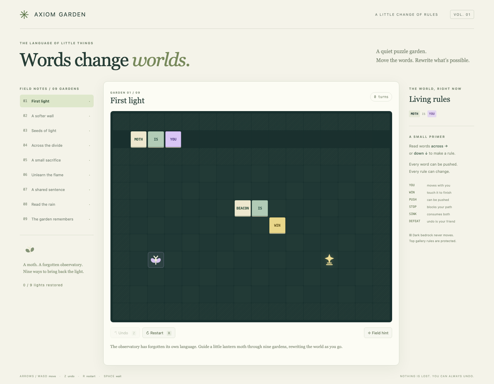

# Axiom Garden

A complete little browser puzzle game about a lantern moth and a forgotten observatory. Move physical word tiles to rewrite the world across nine original gardens.

Inspired by **Baba Is You**, created by Arvi Teikari / Hempuli. This is an independent learning project with original names, SVG art, story, interface and authored levels; no original game assets or level layouts are included.



## Play locally

Requires Node.js 24 and npm.

```sh
npm ci
npm run dev -- --port 5228 --strictPort
```

Open http://127.0.0.1:5228. The app makes no external runtime requests. To build static files, run `npm run build`; deploy `dist/` on any static host. All gardens are available from the start.

## Controls

- Arrow keys or WASD: move one grid step (holding a key repeats turns).
- Z: undo one complete turn, including transformations, destroyed entities and wins.
- R: restart the current garden.
- Space: wait one turn.
- On-screen arrows: touch controls on smaller screens.
- Field hint: reveal a garden-specific hint. Garden list: select any puzzle.

Completion and current input history save automatically in localStorage under `axiom-garden-v1`. Reload preserves your board and undo history. Restart resets the current attempt while retaining completed gardens. Saves belong to the browser and origin; clearing site data clears progress. Storage denial displays a notice and leaves play available.

## Rules implemented

Movable text forms sentences left-to-right and top-to-bottom:

```
MOTH IS YOU
SEED IS BEACON
MOTH AND SEED IS YOU
SEED IS YOU AND WIN
```

All matching objects receive all matching properties; several YOU bodies respond to each input. Rule sentences can overlap and cross, and stacked words contribute possible readings. Text is always PUSH and never transforms. Noun transformations are simultaneous and support multiple targets; a self-identity sentence (SEED IS SEED) protects that noun from other transformations.

| Property | Meaning |
| --- | --- |
| YOU | Each matching object is controllable. Losing all YOU is reversible with undo. |
| PUSH | Push one or many objects in a chain. A blocked chain does not partly move. |
| STOP | Blocks passage unless also PUSH, in which case its push is attempted. |
| WIN | A surviving YOU sharing its cell wins, including YOU also being WIN. |
| SINK | Removes itself and every entity sharing its cell, including words. |
| DEFEAT | Removes YOU sharing its cell. |

A turn uses current rules for movement, reparses words, performs one simultaneous transformation pass, resolves SINK and DEFEAT, then checks WIN. Multiple YOU bodies move frontmost first with stable identity as a tie breaker. Bedrock and board edges are immutable. The top rule gallery is protected by bedrock; ordinary WALL objects obey rules. Active rules are shown beside the board.

## Campaign

1. **First light** — assemble the winning sentence.
2. **A softer wall** — remove STOP to cross a wall.
3. **Seeds of light** — transform a seed into a beacon.
4. **Across the divide** — grant control to a distant seed.
5. **A small sacrifice** — grant PUSH, then bridge SINK with a crate.
6. **Unlearn the flame** — disable a hazard by breaking its sentence.
7. **A shared sentence** — combine YOU and WIN with AND.
8. **Read the rain** — construct a vertical noun transformation.
9. **The garden remembers** — transform a barrier into pushable offerings and cross water.

Literal solutions live in `src/replays.json` (spoilers). Each is executed in engine and browser tests. The tests also verify rules change during each replay and undo returns the exact initial state. These are approachable introductory puzzles, not a full-length campaign or a proof that every alternate route is interesting.

## Scope and differences

This implements a focused, explicitly defined subset of the inspiration. There is no NOT, HAS, MOVE, PULL, FLOAT, OPEN/SHUT, directional predicates, TEXT noun rules, world map, level editor, audio, animation timing simulation or recursive transformation closure. Only the listed seven nouns and six properties exist. Rules do not rewrite the immutable bedrock. Transformation runs once per input, including wait; new nouns can transform again on subsequent inputs. Exact complex collision/stacking precedence is this project's own deterministic model, not a claim of complete Baba Is You compatibility. Undo is attempt-local and can restore a win; switching gardens starts that garden afresh.

## Verification and development

```sh
npm test                         # behavioral engine tests + every campaign replay
npm run build                    # strict TypeScript + production build
npx playwright install chromium  # once, for browser tests
npm run test:browser              # headless Chromium keyboard/touch/save/reload
npm run check                    # all the above checks
```

Tests cover horizontal/vertical/conjoined/stacked parsing, rule recalculation, transformations and identity protection, multi-YOU movement, blocked and stacked push chains, hazards, victory, undo, restart and immutable inputs. Headless browser tests complete all nine gardens using real key inputs, reload each win, check saved progress/partial turns/undo, touch play at 390px, damaged saves and runtime errors. Headless automation is distinct from visible native Chrome acceptance; see `docs/VERIFICATION.md` for the recorded run and review results.

Architecture: `src/engine.ts` is a pure state transition engine; `levels.ts` authors the campaign; `storage.ts` persists replays; `main.ts` renders and handles input; `art.ts` contains original SVG illustrations. See `CONTEXT.md`, `CONTRIBUTING.md` and `docs/PLAN.md`.

Research: the [developer/publisher store description](https://store.steampowered.com/app/736260/Baba_Is_You/) establishes physical rule manipulation, transformations and changing goals. [Hempuli's original jam release](https://hempuli.itch.io/baba-is-you) documents arrows, Z and R controls. The implementation's detailed edge semantics are documented above.

## License

MIT — see the full [LICENSE](LICENSE). Official github/gitignore Global Linux, Windows and macOS contents are included in `.gitignore`, followed by project ignores; provenance is recorded in `docs/GITIGNORE-SOURCES.md`.

## Play online

[Play the hosted game](https://intrepion.github.io/kata-inspired-by-baba-is-you-codex-dot/)
